# herdr.garden

Customizations for the [Herdr](https://herdr.dev) desktop app. Each one installs on its own:

- [Themes](#themes): 11 terminal colour themes.
- [Tab names](#tab-names): names tabs after what runs in them.

```sh
git clone https://github.com/aglowinthefield/herdr.garden
cd herdr.garden
./install.sh themes
```

The install script copies files into `~/.config/herdr-app`, or into `$HERDR_APP_HOME` when it is set. Herdr picks the files up while it runs, so you don't need to restart it.

## Themes

Terminal colour themes. After you install them, choose one in the theme picker in Herdr's settings. Herdr works out the sidebar and panel colours from each theme's terminal colours.

<table>
<tr><td align="center">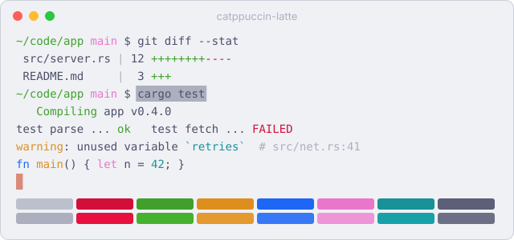<br><code>catppuccin-latte</code></td><td align="center">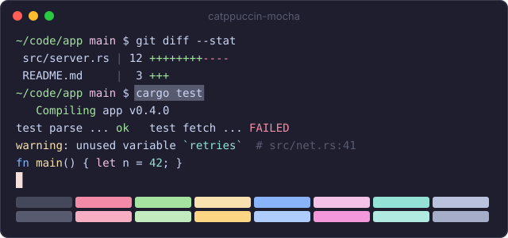<br><code>catppuccin-mocha</code></td></tr>
<tr><td align="center">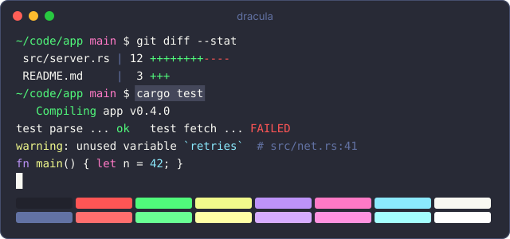<br><code>dracula</code></td><td align="center">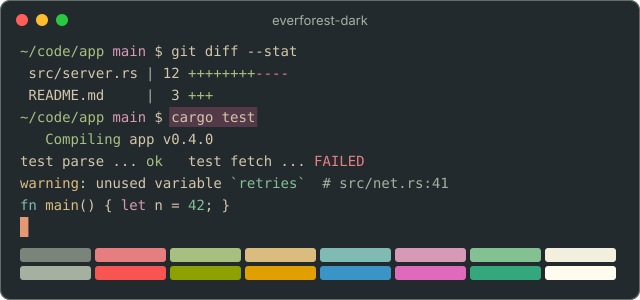<br><code>everforest-dark</code></td></tr>
<tr><td align="center">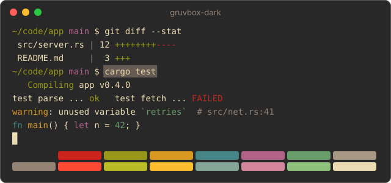<br><code>gruvbox-dark</code></td><td align="center">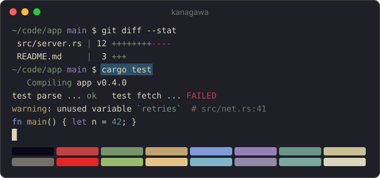<br><code>kanagawa</code></td></tr>
<tr><td align="center">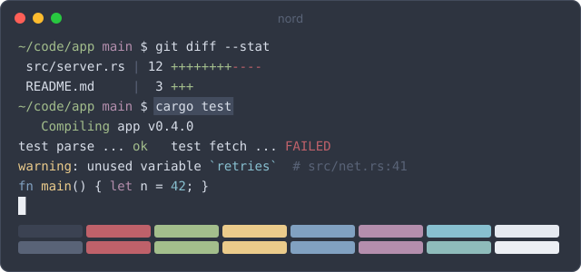<br><code>nord</code></td><td align="center">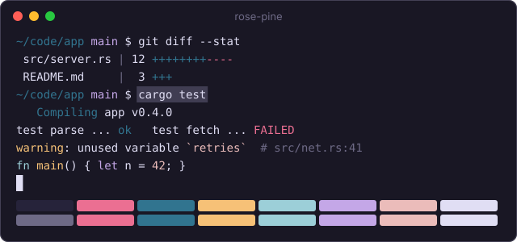<br><code>rose-pine</code></td></tr>
<tr><td align="center">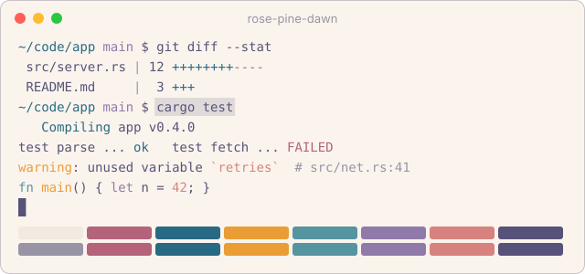<br><code>rose-pine-dawn</code></td><td align="center">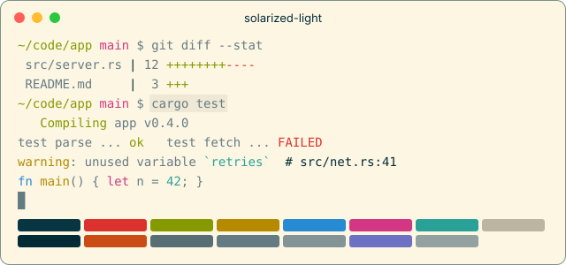<br><code>solarized-light</code></td></tr>
<tr><td align="center">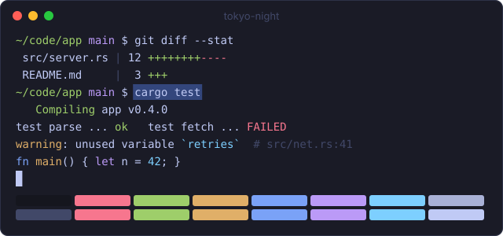<br><code>tokyo-night</code></td></tr>
</table>

To install only some themes, name them:

```sh
./install.sh themes nord tokyo-night
```

To follow the system's light or dark mode, set a pair in `~/.config/herdr-app/settings.json`:

```json
"theme": { "light": "catppuccin-latte", "dark": "catppuccin-mocha" }
```

### Where the colours come from

`scripts/build-themes.py` converts the Ghostty files from a pinned commit of [iTerm2-Color-Schemes](https://github.com/mbadolato/iTerm2-Color-Schemes) (MIT) and draws the previews. Each theme belongs to its original authors.

Herdr keeps selected text in its own colour, so a theme whose selection colour is meant for inverted text would hide it. For those themes (Catppuccin, Kanagawa, and Nord) the script uses the theme's own darker selection colour instead.

| File | Source theme |
|---|---|
| `catppuccin-latte` | Catppuccin Latte |
| `catppuccin-mocha` | Catppuccin Mocha |
| `dracula` | Dracula |
| `everforest-dark` | Everforest Dark Med |
| `gruvbox-dark` | Gruvbox Dark |
| `kanagawa` | Kanagawa Wave |
| `nord` | Nord |
| `rose-pine` | Rose Pine |
| `rose-pine-dawn` | Rose Pine Dawn |
| `solarized-light` | iTerm2 Solarized Light |
| `tokyo-night` | TokyoNight |

To add a theme, add a line to `THEMES` in the script and run it:

```sh
scripts/build-themes.py
```

## Tab names

A mod that names each tab after what runs in it, and updates the name as that changes:

- An agent's task, from its terminal title. pi shows its session name there and Claude Code shows its task.
- A program's title, such as `main.rs` for Neovim, or the program's name.
- A shell's folder, when it differs from the space's folder.

Otherwise the tab keeps Herdr's automatic name, its position. A name has to hold for 4 seconds before the tab changes, so short-lived titles don't flicker.

Tabs you name yourself stay as you named them. To hand a tab back, rename it to an empty name.

```sh
./install.sh tab-names
```

The mod has no view. It runs in a 0 px block at the bottom of the window. Herdr adds that block by itself only to a personal layout, not to the shipped Herdr, Terminals or Herdr 98 layouts. If you use a shipped layout, clone it first, then install:

```sh
herdr-app do layout.clone --name main --as mine
```

Or add the block to a layout file yourself:

```json
{ "type": "block", "content": { "mod": "tab-names" }, "size": { "px": 0 } }
```

To see what it would do without renaming anything, give the block `"props": { "dry_run": true }`. It then writes its choices to the shared value `tab-names.preview`, in `~/.config/herdr-app/shared.json`.

The naming rules are in `mods/tab-names/naming.js`. Run their tests with `node --test mods/tab-names/*.test.js`.

## License

MIT. The colour palettes belong to their authors.
